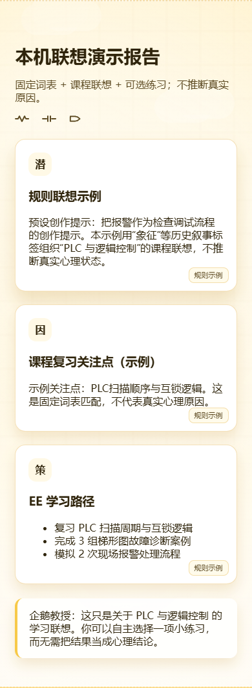

# Penguin Reflection Lab · 企鹅学习联想实验室

把虚构的实验课、面试或调试情节匹配到电气工程课程词表，生成一份小型练习清单。保留原工程的4页导航、企鹅主题、示例按钮和报告展示，公开版明确采用**本机规则**。

**开发中的学习/写作联想原型。不是心理评估、诊断、疗法或真实压力来源分析。** 公开预览默认填入合成场景，不请求定位、不保存输入、不连接模型或上传任何内容；结果来自固定词表，不能据此推断真人心理状态。

[在线离线演示](https://yangwei251003.github.io/penguin-reflection-lab/) · [验证记录](docs/VALIDATION.md) · [许可与素材](THIRD_PARTY_NOTICES.md)



## 最简体验

直接打开仓库中的 `index.html` 即可运行离线页面。也可安装Node.js24后：

```sh
git clone https://github.com/yangwei251003/penguin-reflection-lab.git
cd penguin-reflection-lab
npm run dev
```

打开 **http://127.0.0.1:4176**。没有npm第三方依赖，不需要安装包、账号、密钥或数据库。输入只保存在当前页面内存；刷新/关闭页面会清除，清空按钮可重置界面。只使用虚构内容，不填写真人姓名、联系方式、真实心情/梦境或私人账户。

```sh
npm test
npm run build
```

构建输出 `_site`，Pages工作流仅发布4页HTML、CSS/JS、自有SVG和许可证；始终写入离线配置，不包含API、服务器、环境文件、原未知图片或缓存。相对链接兼容仓库子路径与本地文件。

## 页面与源码

- `index.html`：合成输入、示例词条、本机课程联想、文字报告。
- `how.html`：流程说明；`freud.html`：历史叙事标签与自编示例；`paths.html`：课程练习主题。
- `app.js`：关键词匹配、固定建议、步骤动画；所有结果用文本节点渲染，模型文本不能当HTML插入。
- `runtime-config.js`：公开版固定离线；`assets/`：本次新绘企鹅和背景SVG。
- `server.mjs`、`api/interpret.js`：个人可选后端源码；`tests/`：隔离假请求验证，不代表真实模型通过。

原根没有独立README或许可档；本次补齐自有MIT、素材边界和启动方式。原私有环境/图片/旧Git历史不上传，原目录仍不可删除。

## 可选个人模型模式（未接真实服务验证）

公开Pages只能运行离线前端。若需要自己尝试外部模型，必须在本机私有环境中设置 `PENGUIN_ENABLE_CLOUD=true`、自己的 `ZHIPU_API_KEY`、有权使用的 `ZHIPU_MODEL`，并把 `PENGUIN_ALLOWED_ORIGIN`设为自己的本机网页来源。可以参考空的 `.env.example`，本项目不自动读取任何env文件。

然后明确运行 `npm run dev:private`；页面会改成个人模式提示，勾选“仅发送合成内容”后才向同源后端发送。外部服务可能计费/保存输入，按其官方条款处理，本次没有调用、登录或购买。不要在公开构建、浏览器代码或GitHub中放密钥，也不要发送真实心情/私人资料。

默认后端拒绝模型请求，个人模式限制来源和输入大小、请求超时、错误脱敏；它没有生产认证、限流、滥用控制或完整服务端安全验收，不能直接作为公开心理服务部署。Vercel风格handler仅保留源代码，未做实际部署验证。

## 更新与计划

2026-10-27：增加明确离线/合成边界，移除未经验证的心理因果措辞与外部字体/未知图片，替换为自有SVG；修复不可信结果HTML插入；个人模型需双重显式开启且不回显上游错误。详细[更新记录](CHANGELOG.md)。

后续：改进课程词表与无障碍交互、添加可验证的学习资源链接；个人模型模式须先完成独立权限/隐私/成本与服务验收。自有范围[MIT](LICENSE)，不把第三方材料改授许可。
